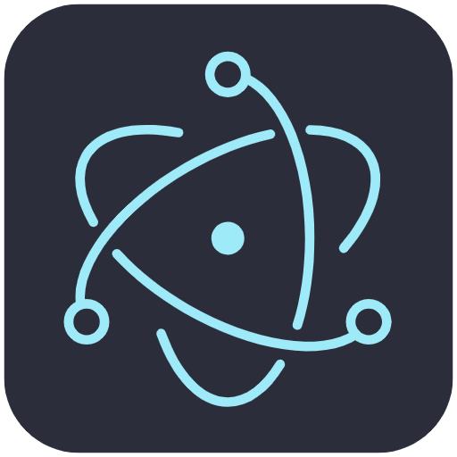

<div align="center">



# Kennel

**A personal VPS manager:** server inventory and costs, SSH terminal, read-only Enpass credentials, and an AI audit of each server through your local Claude Code.

[](https://github.com/isaldin/kennel/actions/workflows/ci.yml)
[](https://github.com/isaldin/kennel/releases/latest)
[](https://github.com/isaldin/kennel/releases)
[](LICENSE)


English · [Русский](README.ru.md)

</div>

> [!NOTE]
> The interface is in Russian. Kennel is built and tested on macOS; the Windows and Linux builds are produced by CI but have not been tested by hand yet.

## Features

- **Inventory.** Server cards with provider, project, monthly cost and currency, billing day, panel URL and notes. Each server lists its services (Docker, Coolify, systemd, other) with a URL and an "expected to run" flag. Servers can be imported from `~/.ssh/config`.
- **SSH terminal.** ssh2 + xterm.js in tabs. Authentication tries ssh-agent, then the IdentityFile (or `~/.ssh/id_*`), then the password from the linked Enpass item. Host keys are checked against `~/.ssh/known_hosts`.
- **Enpass, read-only.** The vault is copied to a temp directory and opened with the master password, which stays in memory only. Passwords never reach the UI: they go to the clipboard (cleared after 30 s) or straight into the SSH login.
- **Server audit.** A read-only script collects a snapshot over SSH: host info, disks, containers and images, systemd units, listening ports, nginx/Caddy vhosts, Traefik labels, cron, TLS certificates. Deterministic rules flag stale images, crash loops, public ports, unknown or missing services, idle servers, full disks and expiring certificates. Servers are re-audited automatically on a schedule.
- **Claude analysis.** The snapshot goes to the Claude Code CLI on your own subscription. Claude explains what runs where and raises problems. It may ask for extra read-only commands from a fixed allowlist, and each one runs only after you confirm it.
- **Chat per finding.** Discuss any finding with Claude. It answers with commands for you to run yourself and never changes anything on the server.
- **Themes.** Dark, light, Nord, Solarized light, Gruvbox, or follow the system, including the terminal palette.

## Download

Get the latest build from **[Releases](https://github.com/isaldin/kennel/releases/latest)**:

| Platform              | File                         |
| --------------------- | ---------------------------- |
| macOS (Apple Silicon) | `kennel-<version>-arm64.dmg` |
| macOS (Intel)         | `kennel-<version>-x64.dmg`   |
| Windows               | `kennel-<version>-setup.exe` |
| Linux                 | `.AppImage` or `.deb`        |

### First launch

The builds are not code-signed yet, so the OS will warn you once.

- **macOS:** if it says the app "is damaged" or "can't be opened", run
  ```bash
  xattr -cr /Applications/Kennel.app
  ```
  or right-click the app → **Open**.
- **Windows:** SmartScreen → **More info** → **Run anyway**.
- **Linux (AppImage):** `chmod +x kennel-*.AppImage` and run it.

## Requirements

- SSH access to your servers. Collection accepts only host keys already in `~/.ssh/known_hosts`, so connect once from the terminal first.
- Optional: [Claude Code](https://docs.anthropic.com/en/docs/claude-code) CLI, logged in, for the AI audit and chats. Without it, audits run with the rule signals only. Kennel looks for `claude` in the login shell's `PATH` and in `~/.local/bin/claude`; set `KENNEL_CLAUDE_BIN` to override.
- Optional: Enpass desktop with a local vault.

## Security model

- **Enpass is read-only.** Kennel never writes to the vault. The master password lives only in memory in the main process.
- **SSH keys stay in `~/.ssh`** and are used through ssh-agent or IdentityFile. They are never copied into the app.
- **Claude can't change your servers.** It runs with no tools of its own and can only _request_ commands from a read-only allowlist (`docker logs/inspect`, `systemctl status`, `journalctl`, reading configs, `ls`, `curl -I` to the server's own domains). Each request is validated and runs only after you confirm it. Output is masked for secrets and truncated before it reaches the model.
- **No passwords in the app database.** The local SQLite database holds the inventory, audit results and chats, and is not encrypted. Credentials stay in Enpass and `~/.ssh`.

## Development

```bash
npm install
npm run dev          # run with HMR
npm test             # vitest
npm run typecheck
npm run lint
npm run build:mac    # or build:win / build:linux
```

Stack: Electron, electron-vite, React 19, TypeScript, ssh2, xterm.js, better-sqlite3-multiple-ciphers.

### Releasing

1. Bump `version` in `package.json` and commit.
2. Tag and push: `git tag v0.1.0 && git push origin v0.1.0`.
3. The [Release workflow](.github/workflows/release.yml) builds macOS, Windows and Linux installers and attaches them to a draft release.
4. Review the draft on GitHub, write the notes and publish it.

## License

[MIT](LICENSE) © Ilya Saldin
